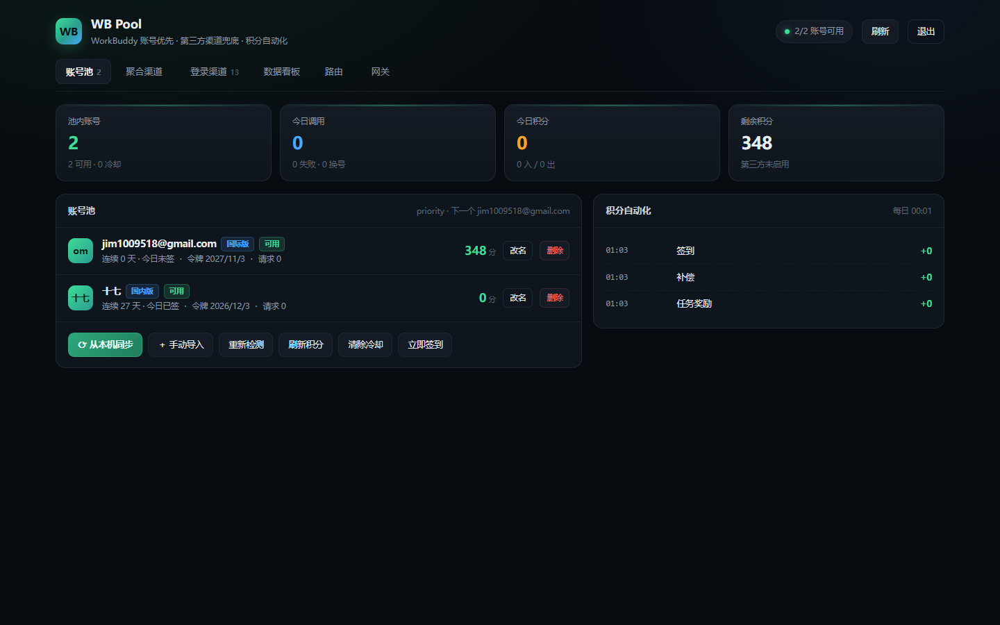
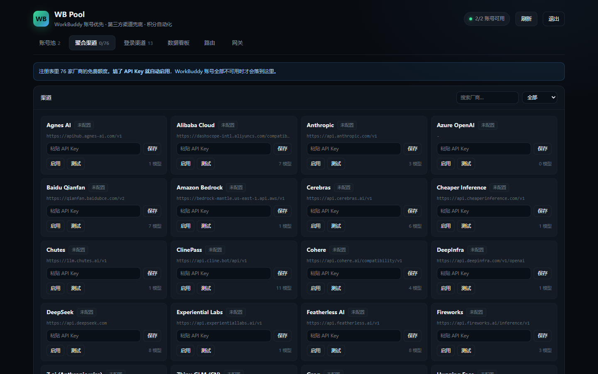
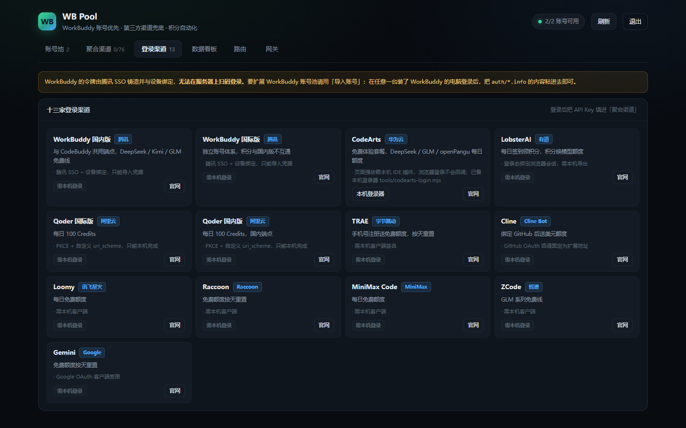
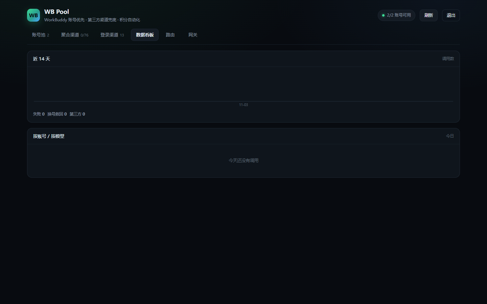
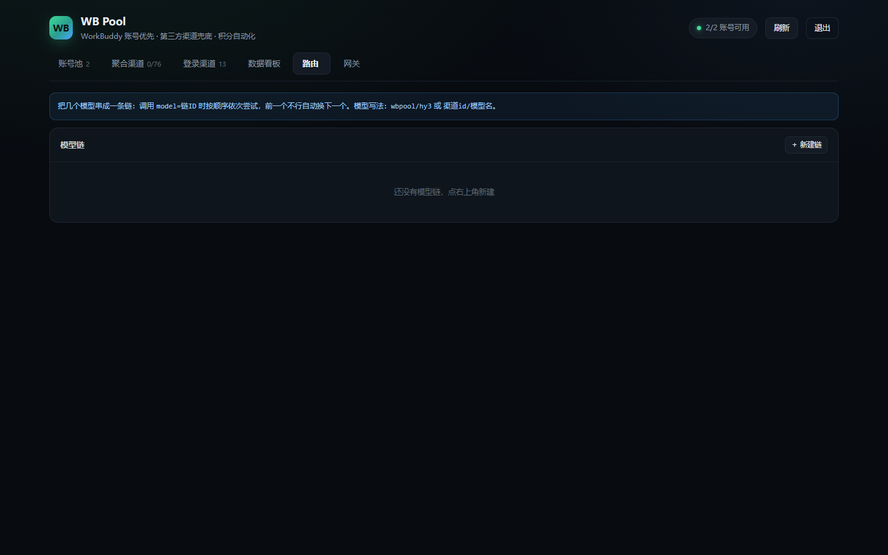
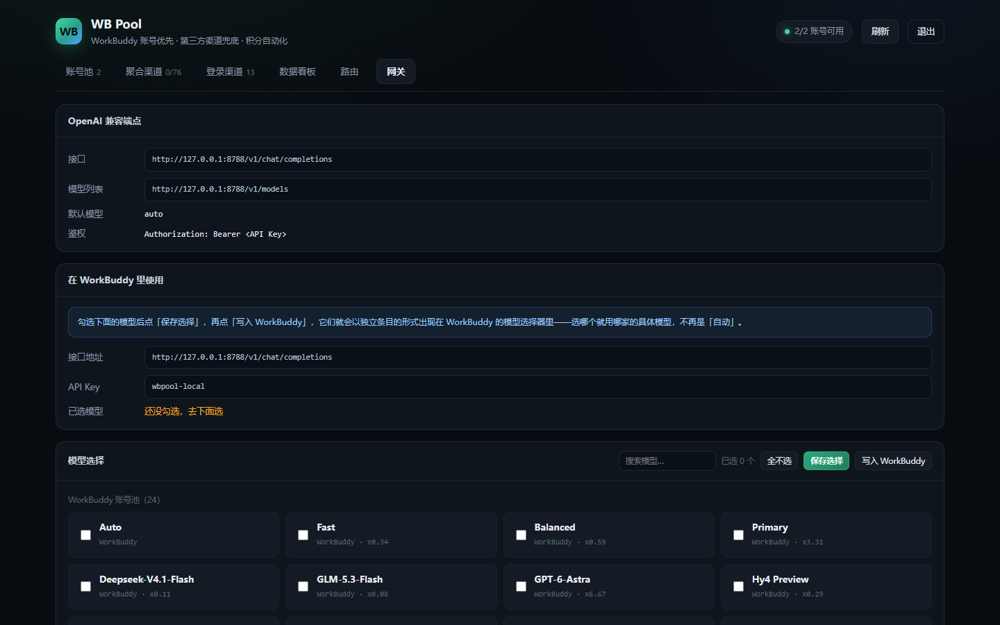

# WorkBuddy AI 聚合池 · WB Pool

[中文](#-中文) | [English](#english)

把 **WorkBuddy 多账号免费额度** 和 **76 家第三方免费渠道** 聚合成一个 OpenAI 兼容端点。
单文件 exe，**双击就能用**，全程只在本机运行，不需要任何服务器。

> 思路参考 [XDTrees/dsh-xdpool](https://github.com/XDTrees/dsh-xdpool)（MIT），把它搬到了 WorkBuddy 上。

---

## 🇨🇳 中文

### 界面预览 / Screenshots

**账号池 / Account Pool** —— 所有账号一目了然：积分、签到、令牌有效期、冷却状态


**聚合渠道 / Providers** —— 76 家免费渠道注册表，填 Key 即点亮


**登录渠道 / Channel Login** —— 支持 OAuth 登录的渠道，页面里直接登录扩池


**数据看板 / Dashboard** —— 调用量、积分消耗、成功率统计


**路由 / Routes** —— 把多个模型串成调用链，按顺序或轮换出请求


**网关 / Gateway** —— OpenAI 兼容端点、模型勾选、一键写入 WorkBuddy


### 它做什么

- **多账号轮换**：自动扫描本机 WorkBuddy 桌面端的登录凭据，多账号收进一个池子；一个号 429 / 积分耗尽就自动换下一个。
- **积分自动化**：每天自动签到、领补偿和任务奖励，池子里所有号一起薅。
- **免费渠道兜底**：内置 76 家第三方渠道注册表（Groq / OpenRouter / SiliconFlow 等），控制台里填个 Key 就点亮。
- **一条端点**：对外只暴露 `http://127.0.0.1:8788/v1/chat/completions`，WorkBuddy / 任何 OpenAI 兼容客户端都能接。
- **控制台**：账号状态、积分、模型勾选、渠道管理、调用统计，一个页面全有。

```
WorkBuddy 桌面端 / 任意 OpenAI 客户端
        │  模型选「WB Pool」
        ▼
POST http://127.0.0.1:8788/v1/chat/completions
        │
┌───────┴────────────────────────────┐
│  wbpool 网关（本机）                 │
│  1. WorkBuddy 账号池（优先）         │
│     429 → 冷却换号；积分尽 → 长休息   │
│  2. 第三方免费渠道（兜底）            │
│  3. 自动签到 / 任务奖励（后台定时）   │
└────────────────────────────────────┘
```

### 快速开始

1. 到 [Releases](../../releases) 下载 `wbpool-local-win-x64.exe`（约 84 MB，免安装）。
2. 双击运行 —— 它会自动：
   - 扫描本机 WorkBuddy 登录过的账号（需要装过 WorkBuddy 并登录过一次）
   - 在 `127.0.0.1:8788` 起网关
   - 把「WB Pool」注册进 WorkBuddy 的模型列表
   - 打开浏览器进控制台
   - **注册开机自启**（`%LOCALAPPDATA%\wbpool\WB Pool.exe` + 注册表 `HKCU\...\Run\WBPool`），重启电脑后服务自动就绪，随时双击 exe 直接打开控制台
3. 在 WorkBuddy 模型选择器里选 **WB Pool · 自动（多账号池）**，开聊。
   想指定具体模型，先在控制台「网关」页勾选，点「写入 WorkBuddy」，模型列表里就会出现独立条目。

> **v0.2.0 起无黑色命令窗口**：exe 为 GUI 子系统，双击后台静默运行并自动打开控制台；
> 重复双击不会起第二个实例，只会再次打开页面。
> 取消自启：删除注册表 `HKCU\Software\Microsoft\Windows\CurrentVersion\Run` 里的 `WBPool` 键。

**没装 WorkBuddy 也能用**：打开控制台 →「聚合渠道」页 → 填任意一家免费渠道的 API Key。

### 隐私与安全

- 所有凭据只落在本机 `%USERPROFILE%\.wbpool\`，**不经过、不上传任何第三方服务器**。
- 网关只绑定 `127.0.0.1`，局域网里别人碰不到。
- 停止服务：任务管理器结束「WB Pool」进程；数据随时可整目录删除。

### 从源码构建

要求：Node.js 22+，Windows。

```bash
npm install --no-save postject
node tools/build-local-exe.mjs
# 产物：dist/WB Pool 本地版.exe（同时复制一份到桌面）
```

不想构建也可以直接跑源码：

```bash
node local.mjs          # 双击 exe 做的事，源码版
node src/cli.mjs serve  # 纯网关模式
node src/cli.mjs doctor # 体检：解密 / 上游连通性 / 渠道
node tools/selftest.mjs # 池路由自测
```

### 配置

首启自动生成 `%USERPROFILE%\.wbpool\config.json`，常用项：

| 字段 | 默认 | 说明 |
| --- | --- | --- |
| `port` | `8788` | 网关端口（被占用会自动往后找） |
| `distribution` | `priority` | 分配策略：`priority` / `round-robin` / `balanced` / `sticky` / `expiry` |
| `cooldownMs` | `60000` | 429 冷却时长 |
| `providers` | `{}` | 第三方渠道：`{ "groq": { "apiKey": "…", "enabled": true } }` |
| `selectedModels` | `[]` | 要注册成独立模型条目的模型 id |
| `automation` | 开 | 每日签到 / 奖励领取时间点 |

### 开发者说明（源码结构）

```
local-entry.cjs        SEA 主脚本：解包运行时 → 加载 local.mjs
local.mjs              本地版入口：扫号、起网关、注册模型、开控制台
src/core/gateway.mjs   HTTP 网关与控制台 API（/v1/chat/completions + /api/*）
src/core/accounts.mjs  账号池：扫描、冷却、分配策略
src/core/at-rest.mjs   WorkBuddy 凭据解密（AES-256-GCM 信封）
src/core/upstream.mjs  WorkBuddy 上游客户端、模型目录、签到 / 积分
src/core/providers.mjs 第三方渠道转发
src/automation.mjs     每日签到 / 奖励定时任务
ui/                    控制台与登录页
data/providers-registry.json  76 家免费渠道注册表
```

---

## English

### What it does

**WB Pool** aggregates **multiple WorkBuddy free-tier accounts** plus **76 third-party free providers** into a single OpenAI-compatible endpoint. One standalone exe — **double-click and it works** — everything runs locally, no server required.

- **Multi-account rotation**: scans WorkBuddy desktop credentials on your machine, pools them together; a rate-limited or exhausted account is skipped automatically.
- **Credit automation**: daily check-in, compensation and task rewards are claimed for every account.
- **Free-provider fallback**: a built-in registry of 76 third-party providers (Groq / OpenRouter / SiliconFlow, etc.) — paste an API key in the console to enable.
- **One endpoint**: everything is exposed at `http://127.0.0.1:8788/v1/chat/completions`, usable from WorkBuddy or any OpenAI-compatible client.
- **Console**: accounts, credits, model selection, provider management and usage stats in one page.

### Quick start

1. Grab `wbpool-local-win-x64.exe` (~84 MB, no install) from [Releases](../../releases).
2. Double-click it. It will:
   - scan accounts you have logged into with the WorkBuddy desktop app
   - start the gateway on `127.0.0.1:8788`
   - register "WB Pool" into WorkBuddy's model list
   - open the web console in your browser
   - **enable auto-start on boot** (`%LOCALAPPDATA%\wbpool\WB Pool.exe` + registry `HKCU\...\Run\WBPool`), so the service is ready after every reboot — and double-clicking the exe later just opens the console
3. Pick **WB Pool · Auto** in WorkBuddy's model selector and chat away. To expose specific models, tick them on the **Gateway** page and click *Write into WorkBuddy*.

> **Since v0.2.0 there is no black console window**: the exe is a GUI-subsystem binary that runs silently in the background and opens the console automatically.
> Double-clicking again never spawns a second instance — it just reopens the page.
> To disable auto-start, delete the `WBPool` value under `HKCU\Software\Microsoft\Windows\CurrentVersion\Run`.

**No WorkBuddy installed?** Still works: open the console → *Providers* tab → paste any free provider's API key.

### Privacy & security

- All credentials stay in `%USERPROFILE%\.wbpool\` on your machine — **nothing is sent to any third-party server**.
- The gateway binds to `127.0.0.1` only.
- To stop the service, end the "WB Pool" process in Task Manager; delete the data folder to remove everything.

### Build from source

Requires Node.js 22+, Windows.

```bash
npm install --no-save postject
node tools/build-local-exe.mjs
# Output: dist/WB Pool 本地版.exe (also copied to your Desktop)
```

Or run straight from source:

```bash
node local.mjs          # what the exe does
node src/cli.mjs serve  # gateway only
node src/cli.mjs doctor # diagnose decryption / upstream / providers
node tools/selftest.mjs # pool routing self-test
```

### Configuration

A default `%USERPROFILE%\.wbpool\config.json` is created on first launch. Common fields:

| Field | Default | Description |
| --- | --- | --- |
| `port` | `8788` | Gateway port (auto-increments if taken) |
| `distribution` | `priority` | `priority` / `round-robin` / `balanced` / `sticky` / `expiry` |
| `cooldownMs` | `60000` | 429 cooldown duration |
| `providers` | `{}` | Third-party providers: `{ "groq": { "apiKey": "…", "enabled": true } }` |
| `selectedModels` | `[]` | Model ids registered as standalone WorkBuddy entries |
| `automation` | on | Daily check-in / reward schedule |

### Source layout

```
local-entry.cjs        SEA bootstrap: unpack runtime → import local.mjs
local.mjs              Local edition entry: scan, serve, register, open console
src/core/gateway.mjs   HTTP gateway & console API (/v1/chat/completions + /api/*)
src/core/accounts.mjs  Account pool: scanning, cooldown, distribution strategies
src/core/at-rest.mjs   WorkBuddy credential decryption (AES-256-GCM envelopes)
src/core/upstream.mjs  WorkBuddy upstream client, model catalog, check-in / credits
src/core/providers.mjs Third-party provider relaying
src/automation.mjs     Daily check-in / reward scheduler
ui/                    Console & login pages
data/providers-registry.json  Registry of 76 free providers
```

## License

[MIT](LICENSE). `data/providers-registry.json` is ported from [dsh-xdpool](https://github.com/XDTrees/dsh-xdpool) (MIT).
